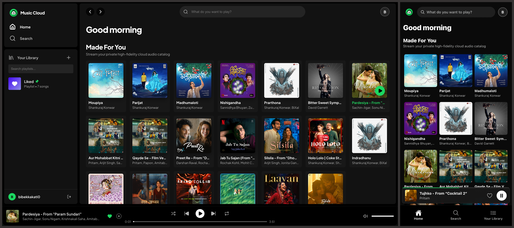

<p align="center">
  
</p>

<h1 align="center">Music Cloud</h1>

<p align="center">
  <strong>High-fidelity, private self-hosted music streaming platform and automated audio transcode pipeline.</strong>
</p>

<p align="center">
  <a href="https://turbo.build/repo"></a>
  <a href="https://fastapi.tiangolo.com/"></a>
  <a href="https://react.dev/"></a>
  <a href="https://expo.dev/"></a>
  <a href="https://workers.cloudflare.com/"></a>
  <a href="https://ffmpeg.org/"></a>
  <a href="https://ai.google.dev/"></a>
</p>

---

## Overview

**Music Cloud** is an end-to-end, private music streaming platform architected as a polyglot monorepo. It couples an asynchronous Python backend and automated FFmpeg transcoding engine with a modern web player, native mobile applications (iOS and Android), and a globally distributed Cloudflare Edge Worker delivering tokenized HLS audio streams directly from Cloudflare R2 object storage.

---

## User Interface & Experience

<p align="center">
  
</p>

---

## Core Features

### 🎧 Web Client (React 19 & Vite)
- **High-Fidelity Audio Player**: Gapless HLS playback via `hls.js`, persistent volume memory, queue management, repeat/shuffle modes, and local state preservation across page reloads.
- **Dark Spotify-Inspired Interface**: Modern, responsive layout with glassmorphic accents, curated collections, and responsive side drawers.
- **Admin Studio**: Dedicated administrator dashboard featuring direct S3/R2 track uploads, processing status monitoring, metadata editing, song inspection modals, catalog filtering by processing state, and manual AI property synchronization.

### 📱 Native Mobile App (Expo SDK 57 & React Native)
- **Native Media Playback**: Powered by `react-native-track-player` for reliable background streaming, lock screen media controls, notification center actions, and audio session management.
- **Offline Download Storage**: Songs can be downloaded directly to local storage and indexed in SQLite, enabling full offline playback without network access.
- **Guest Access**: Seamless experience for unauthenticated users, providing access to downloaded songs while preserving dark theme aesthetics.
- **Configurable Backend Server**: In-app Settings screen to dynamically configure and persist custom self-hosted backend URLs with validation and reset capabilities.

### ⚡ Backend API & Audio Engine (FastAPI & Python 3.14)
- **Fast Asynchronous Architecture**: FastAPI application powered by SQLModel, PostgreSQL, and connection pooling.
- **Redis & BullMQ Pipeline**: Offloads intensive audio analysis, transcoding, and artwork extraction jobs to asynchronous background workers.
- **Typo-Tolerant Catalog Search**: In-memory search indexing via RapidFuzz providing instant, typo-tolerant query resolution without external search engines.
- **Secure Session Management**: SHA-256 hashed bearer tokens stored in database with an in-memory cache and sliding-window rate limiting.

### 🤖 AI-Powered Metadata Extraction (Google Gemini)
- **Automated Property Identification**: Automatic detection and classification of genre, moods, and language based on song title, artist, and album.
- **Multi-Model Fallback & Rate Resilience**: Uses `gemini-3.1-flash-lite` and `gemini-3.5-flash-lite` with rate-limit pacing and automatic retry backoff.
- **Batch Synchronization CLI**: Built-in CLI command to synchronize properties across the entire song catalog while respecting API quotas.

### 🌐 Edge CDN & Tokenized Streaming (Cloudflare Workers & R2)
- **Authenticated HLS Delivery**: Edge worker validates short-lived HMAC-SHA256 JWT tokens passed as query parameters (`?token=...`), avoiding CORS preflight round-trips for instant playback start.
- **Static Asset Caching**: Serves cover art with immutable cache headers and conditional `ETag` / `304 Not Modified` handling.
- **Storage Protection**: Private audio storage keys and master sources are completely shielded from public exposure.

---

## How It Works

```text
+-----------------------------------------------------------------------------------------+
|                                    UPLOAD & INGESTION                                   |
|                                                                                         |
|  Admin Client                  FastAPI Backend                 Cloudflare R2 Storage    |
|       |                               |                                  |              |
|       |--- 1. Request Upload URL ---->|                                  |              |
|       |<-- 2. Presigned PUT URL ------|                                  |              |
|       |                                                                  |              |
|       |-------------------- 3. Direct Upload Raw Audio ----------------->|              |
|       |                                                                                 |
|       |--- 4. Trigger Processing ---->|                                                 |
|                                       |--- Enqueue Job in Redis/BullMQ                  |
+-----------------------------------------------------------------------------------------+

+-----------------------------------------------------------------------------------------+
|                                AUDIO TRANSCODE PIPELINE                                 |
|                                                                                         |
|  BullMQ Worker                 FFmpeg / FFprobe                  Cloudflare R2          |
|       |                               |                                |                |
|       |--- Download Source File ----->|                                |                |
|       |--- Inspect Audio Track ------>| (Duration, Bitrate, Tags)      |                |
|       |--- Extract Cover Image ------>| (Optimized JPEG)               |                |
|       |--- Transcode & Segment ------>| (Multi-bitrate AAC, 10s chunks)|                |
|       |--- Generate Master Playlist ->| (master.m3u8)                  |                |
|       |--- Identify Properties ------>| (Genre, Moods, Language)       |                |
|       |                                                                |                |
|       |------------------- Upload Segments & Playlists --------------->|                |
|       |--- Update PostgreSQL Record (Status = READY)                   |                |
+-----------------------------------------------------------------------------------------+

+-----------------------------------------------------------------------------------------+
|                               AUTHENTICATED EDGE PLAYBACK                               |
|                                                                                         |
|  Web / Mobile Client           FastAPI Backend   Cloudflare Edge Worker   Cloudflare R2 |
|       |                               |                    |                    |       |
|       |--- 1. Request Stream Token -->|                    |                    |       |
|       |<-- 2. Signed JWT Token -------|                    |                    |       |
|       |                                                    |                    |       |
|       |--- 3. GET /master.m3u8?token=<JWT> --------------->|                    |       |
|       |                                                    |-- Verify Token     |       |
|       |                                                    |-- Fetch Playlist ->|       |
|       |<-- 4. Stream HLS Segments (.ts / .m4s / .aac) -----|                    |       |
+-----------------------------------------------------------------------------------------+
```

---

## Audio Processing Pipeline

1. **Inspection**: `ffprobe` extracts exact duration, sample rate, channel layout, source bitrate, and existing audio container tags.
2. **Artwork Extraction**: Embedded album artwork is extracted into standardized JPEG assets; fallback to uploaded cover art if embedded image is absent.
3. **Conservative Transcoding**: The source audio is transcoded into AAC streams. Encoding targets standard bitrates (256 kbps, 320 kbps) without upscaling lower-bitrate source files.
4. **HLS Packaging**: Audio is sliced into 10-second media segments (`.ts` / `.aac`) alongside variant playlists and a top-level `master.m3u8` playlist.
5. **AI Metadata Tagging**: The Gemini AI agent inspects song metadata to categorize genre, moods, and primary language, mapping them against normalized master lookup tables.
6. **Concurrent Cloud Upload**: Playlists, segments, and cover art are uploaded to Cloudflare R2 using a throttled asynchronous connection pool before purging local scratch files.

---

## Monorepo Structure

```text
music-cloud/
├── apps/
│   ├── api/            # FastAPI backend, BullMQ transcode worker, AI agent
│   ├── web/            # React 19 + Vite web client & admin dashboard
│   ├── mobile/         # Expo SDK 57 + React Native mobile app (iOS & Android)
│   └── edge-worker/    # Cloudflare Worker for tokenized HLS streaming & CDN
│
├── packages/
│   ├── services/       # Shared API client methods for web and mobile
│   ├── types/          # Shared TypeScript models, API contracts, and JWT claims
│   ├── utils/          # Cross-platform utilities, string helpers, and token formats
│   └── tsconfig/       # Shared TypeScript configuration presets
│
├── assets/             # Branding assets, application screenshots, and logo
├── package.json        # Workspace scripts and root dependencies
└── turbo.json          # Turborepo build pipeline configuration
```

---

## System Requirements

Ensure the following tools are installed on your host machine:

| Requirement | Supported Version | Notes |
| :--- | :--- | :--- |
| **Node.js** | `^20.18.0` or `>=22.0.0` | Recommended via `nvm` or `fnm` |
| **npm** | `>=10.0.0` | Workspaces package manager |
| **Python** | `>=3.14.0` | Required for FastAPI backend |
| **uv** | `>=0.4.0` | Ultra-fast Python package and project manager |
| **FFmpeg & FFprobe** | `>=6.0` | Must be available on system `$PATH` |
| **PostgreSQL** | `>=15.0` | Primary application database (with `pg_trgm` extension) |
| **Redis** | `>=7.0` | Background task queue for BullMQ worker |

---

## Environment Configuration

Each application within `apps/` contains an `.env.example` file documenting all required and optional environment variables:

- **API Backend**: [`apps/api/.env.example`](apps/api/.env.example) (Database URL, Redis URL, S3/R2 credentials, Gemini API key, Auth secrets)
- **Web Client**: [`apps/web/.env.example`](apps/web/.env.example) (`VITE_API_BASE_URL`)
- **Mobile Client**: [`apps/mobile/.env.example`](apps/mobile/.env.example) (`EXPO_PUBLIC_API_BASE_URL`)
- **Edge Worker**: [`apps/edge-worker/.env.example`](apps/edge-worker/.env.example) (`AUTH_SECRET`, `ALLOWED_ORIGINS`)

To get started, copy the template in each app directory and fill in your values:

```bash
cp apps/api/.env.example apps/api/.env
cp apps/web/.env.example apps/web/.env
cp apps/mobile/.env.example apps/mobile/.env
cp apps/edge-worker/.env.example apps/edge-worker/.env
```

---

## How to Run

### 1. Installation

Install all JavaScript/TypeScript workspace dependencies and Python virtual environment:

```bash
# Install root and workspace npm dependencies
npm install

# Setup Python dependencies in apps/api
cd apps/api && uv sync && cd ../..
```

### 2. Running Applications

You can start services concurrently or run each component independently:

#### Start API & Web Together
```bash
npm run dev
```

#### Run Individual Applications
```bash
# FastAPI Backend (http://localhost:8000)
npm run dev:api

# React Web Client (http://localhost:5173)
npm run dev:web

# Cloudflare Edge Worker (http://localhost:8787)
npm run dev:worker

# Expo Mobile App (Metro Bundler)
npm run dev:mobile
```

For platform-specific mobile execution (from `apps/mobile`):
```bash
# Run on Android Emulator / Device
npm run android --workspace=@music-cloud/mobile

# Run on iOS Simulator (macOS only)
npm run ios --workspace=@music-cloud/mobile
```